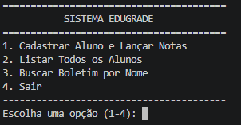
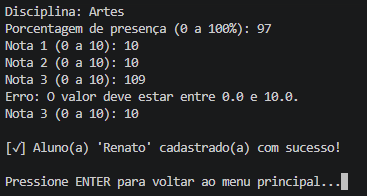
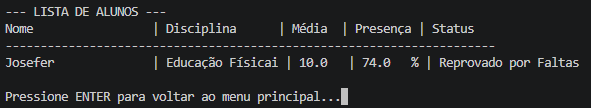
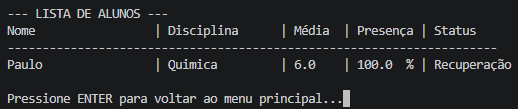
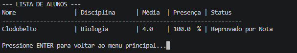
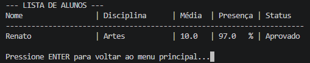
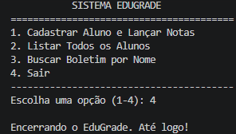

# 🎤 Roteiro de Apresentação - Projeto EduGrade

**Aluno:** Matheus Talasso Gil  
**Projeto:** EduGrade - Sistema de Gestão Escolar (CLI)  
**Metodologia:** Scrum & Kanban  
**Linguagem:** Python 3  

---

## 1. Introdução
> "Olá, professor! Meu nome é Matheus Talasso Gil e vou apresentar o **EduGrade**, um sistema em linha de comando (CLI) desenvolvido em Python para automatizar a gestão de notas, presença e boletins escolares."

---

## 2. Metodologia Ágil e Engenharia de Requisitos
> "Durante o projeto, utilizei os ritos do **Scrum** divididos em Sprints e gerenciei o fluxo através do quadro **Kanban**. Mapeei as seguintes regras de negócio principais:"

* **Frequência Mínima:** Alunos com presença abaixo de 75% são **Reprovados por Faltas**, independentemente das notas.
* **Aprovação por Nota:** Média igual ou superior a 7.0 garante a aprovação direta.
* **Recuperação e Reprovação:** Média entre 5.0 e 6.9 coloca o aluno em **Recuperação**; abaixo de 5.0 gera **Reprovação por Nota**.
* **Navegação e Validação:** Bloqueio de nomes contendo apenas números e confirmação por **ENTER** para evitar que a tela feche antes da leitura.

---

## 3. Demonstração Prática da CLI (Evidências do Sistema)

### Passo 1: Menu Principal e Cadastro de Alunos
> "O sistema inicia exibindo o menu principal interativo. Na opção 1, realizamos o cadastro informando nome, disciplina, presença e as 3 notas com validações automáticas de limites."

---

### Passo 2: Testes das Regras de Negócio (Casos de Uso)

> "Para comprovar o funcionamento das regras de negócio, foram executados os testes cobrindo todos os cenários de avaliação:"

#### A) Reprovado por Falta (Presença < 75%)

#### B) Recuperação (5.0 <= Média < 6.9)

#### C) Reprovado por Nota (Média < 5.0)

---

### Passo 3: Listagem Geral da Turma
> "Na opção 2, o sistema exibe a lista completa formatada com todos os alunos cadastrados, suas médias calculadas e situações finais:"

---

### Passo 4: Encerramento do Sistema
> "A opção 4 finaliza a aplicação de forma limpa no terminal:"

---

## 4. Retrospectiva Scrum & Conclusão
* **O que funcionou bem:** A estruturação modular em Python com funções bem definidas para cada menu e regra de negócio.
* **O maior desafio:** Garantir o tratamento adequado de exceções e criar a pausa de navegação com a tecla **ENTER** para uma melhor experiência do usuário (UX).

> *"Obrigado!"*